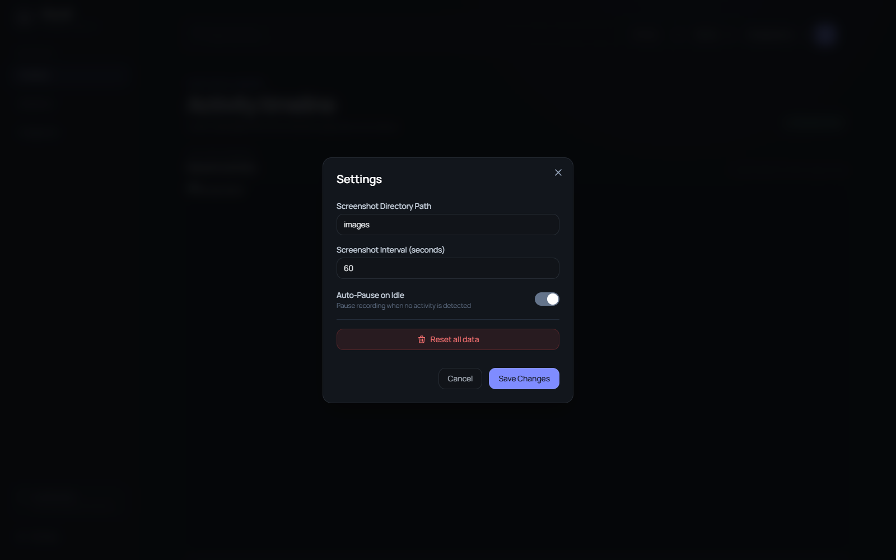

<div align="center">
  

# Recollect

**A quiet timeline of your workday.**

Capture desktop moments, then search a private activity timeline stored on your Windows PC.

[](https://github.com/kargalar/recollect/releases/latest) [](https://github.com/kargalar/recollect/releases/latest) [](LICENSE)

[Download for Windows ↓](https://github.com/kargalar/recollect/releases/latest) · [Build from source](#build-from-source) · [Report an issue](https://github.com/kargalar/recollect/issues)

</div>



## Review your day

Recollect captures desktop activity at a configurable interval and organizes each moment in a searchable timeline. Pause capture when you are away, filter by app, and review local settings from the web interface.

## Features

- Capture the active desktop at a configurable interval.
- Search and browse a local timeline with window and app details.
- Pause automatically while the computer is idle.
- Control recording from the Windows system tray.
- Keep screenshots and activity data on your device.

## Download and run

Download `Recollect-Windows-x64.zip` from [Releases](https://github.com/kargalar/recollect/releases/latest), extract the complete archive to a writable folder, and run `Recollect.exe`. Keep `RecollectApi.exe`, `RecollectRecorder.exe`, and the other bundled files beside it.

Review the screenshot folder and capture settings before enabling recording. Window titles, OCR text, and screenshots may contain sensitive information.

## Build from source

Requirements: Windows 10 or later, Python 3.12+, Tesseract OCR, and the packages in `requirements.txt`.

```powershell
py -m venv .venv
.\.venv\Scripts\Activate.ps1
pip install -r requirements.txt
python app\tray.py
```

For a packaged release, install PyInstaller and run `build.ps1`. The executables are written under `dist/`.

## License

Recollect is licensed under the GNU General Public License v3.0. See [LICENSE](LICENSE).
